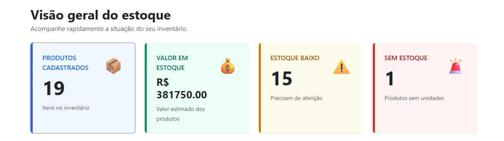
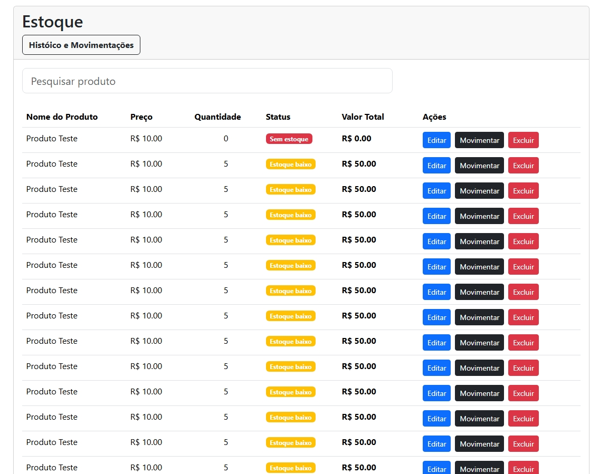
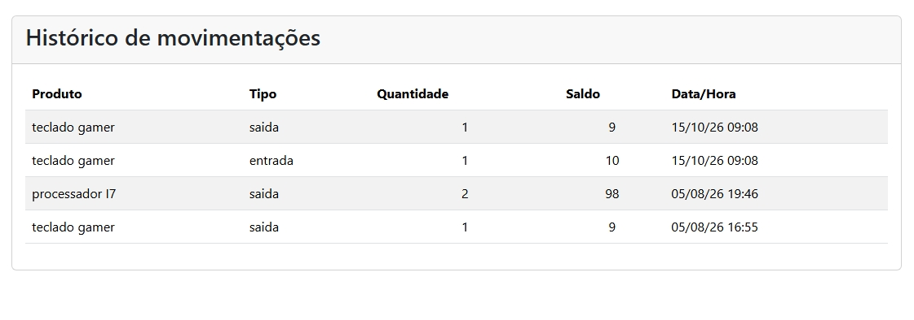

# Sistema de Controle de Produtos e Estoque

Projeto desenvolvido para praticar desenvolvimento backend com Python e Flask, com foco no gerenciamento de produtos e no controle de estoque.

## Funcionalidades

- Cadastro, consulta, edição e exclusão de produtos
- Pesquisa e filtros de estoque
- Autenticação de usuários e proteção de rotas
- Registro de movimentações de estoque
- Interface dinâmica para consulta de produtos

## Tecnologias

- Python
- Flask
- SQLAlchemy
- SQLite
- JavaScript
- HTML e CSS
- Pytest

## Demonstração visual

### Dashboard

### Listagem e pesquisa de produtos

### Movimentações de estoque

### Listagem e Cadastro de Fornecedor

---

Este repositório apresenta capturas de tela da aplicação. O código-fonte está disponível separadamente, conforme as configurações de acesso do repositório principal.
